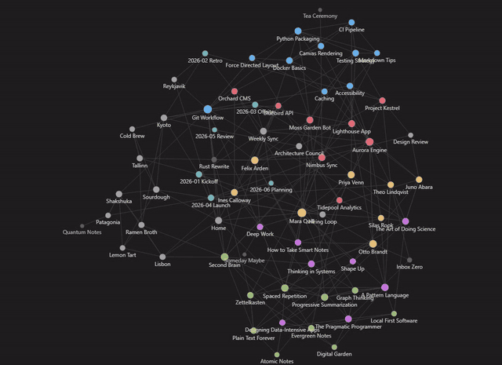
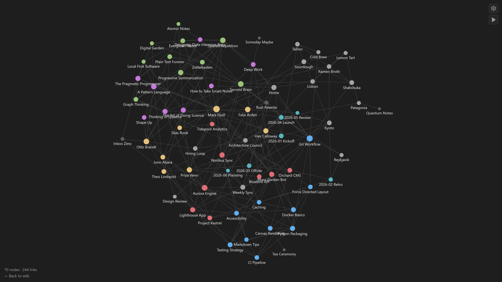
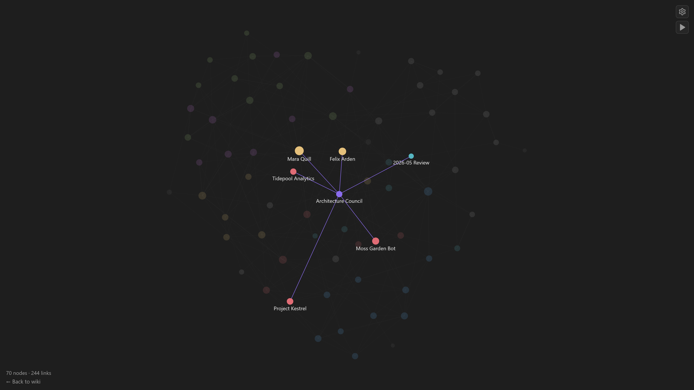
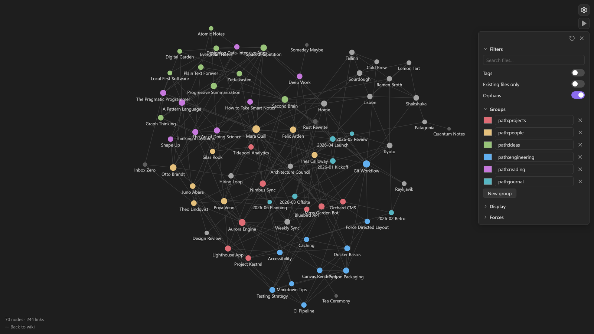
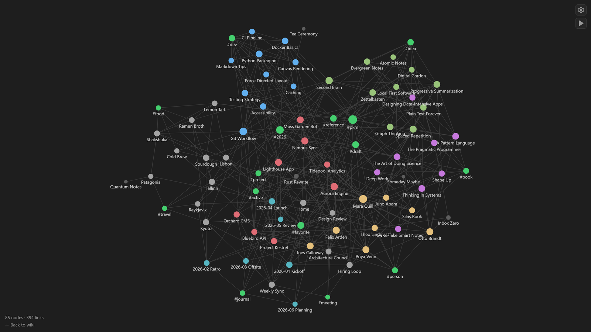
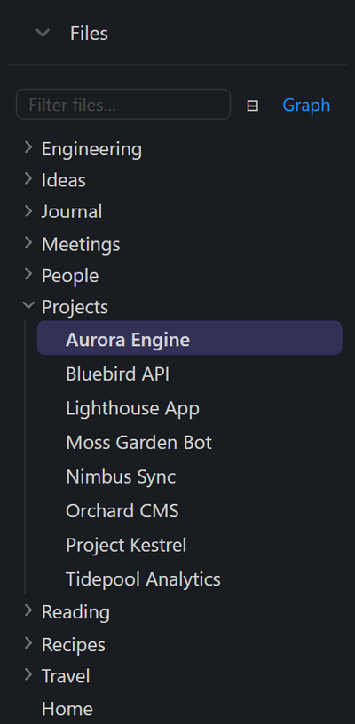
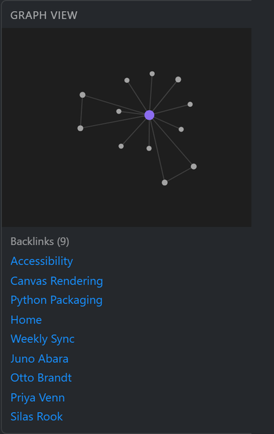
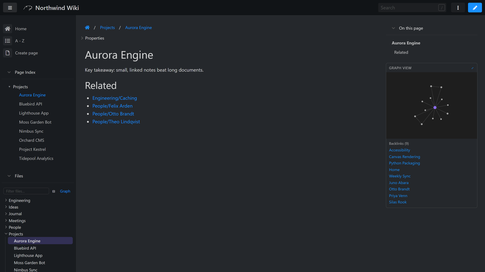
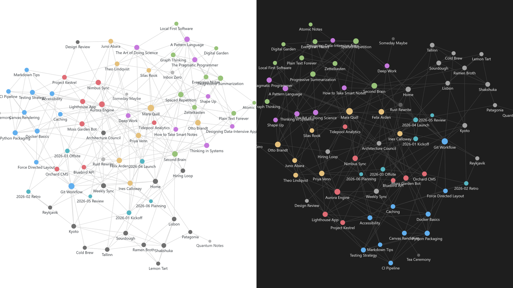
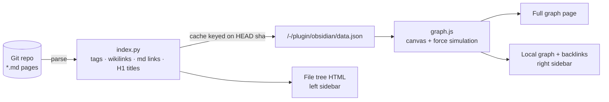

<div align="center">

# otterwiki-obsidian

**Obsidian's graph view and file explorer, inside [An Otter Wiki](https://otterwiki.com).**

See how your notes connect: an interactive force-directed graph, a collapsible file tree,
and a local graph with backlinks on every page. One `pip install`, zero JavaScript libraries.

[](https://otterwiki.com)
[](pyproject.toml)
[](pyproject.toml)
[](#security--privacy)
[](#license)



[▶ Demo video](https://youtu.be/l9ViIzmZAw4) · [Features](#features) · [Install](#install) · [Using the graph](#using-the-graph) · [How it works](#how-it-works) · [FAQ](#faq)

</div>

### ▶ See it in 50 seconds

<p align="center">
  <a href="https://youtu.be/l9ViIzmZAw4">
    
  </a>
</p>

> [!NOTE]
> All screenshots come from a demo wiki with made-up content (*Northwind Wiki*). Your wiki will look the same, with your own notes.

---

## Why

Otterwiki is a great self-hosted, git-backed Markdown wiki. Once a wiki grows past a few dozen pages, though,
it gets hard to see **what links to what**. Obsidian solved this with its graph view and file explorer.
This plugin adds both to Otterwiki, using the look, colours and settings Obsidian users already know.

<p align="center">
  
</p>

## Features

### 🕸️ Graph view: your whole wiki at a glance

A full-screen, canvas-rendered, force-directed graph at `/-/plugin/obsidian/graph`.
Every page is a node and every link is an edge. Nodes grow with their number of connections, so your hub notes stand out.

- **Pan, zoom, drag** nodes around; **click** to open a page, **Ctrl/⌘-click** to open it in a new tab
- **Animate** (▶) replays the graph growing breadth-first from your biggest hub
- **Ghost nodes**: `[[wikilinks]]` to pages that don't exist yet show up dimmed, just like in Obsidian
- Opens **already laid out**: the simulation settles off-screen before the first frame

### 🎯 Hover to focus

Hover any note and its neighbourhood lights up in the accent colour while the rest of the graph fades out.

<p align="center"></p>

### 🎛️ The settings panel you know from Obsidian

Click ⚙ for the same four sections as Obsidian. Settings are saved in your browser.

<p align="center"></p>

| Section | Settings |
|---|---|
| **Filters** | Search query · Tags as nodes · Existing files only · Orphans · Local/Global + **Depth** (1–5), incoming/outgoing links |
| **Groups** | Unlimited colour groups, each defined by a [search query](#search--group-queries) (`path:projects`, `tag:book`, …) |
| **Display** | Arrows · Text fade threshold · Node size · Link thickness · Animate |
| **Forces** | Center force · Repel force · Link force · Link distance |

### 🏷️ Tags as nodes

Turn on **Tags** and every frontmatter tag becomes its own green node, so notes that share tags cluster together.

<p align="center"></p>

### 📁 File tree, 🔗 local graph and ↩️ backlinks on every page

<table>
<tr>
<td width="50%" valign="top">

**File tree** in the left sidebar
- Folders first, A→Z, collapsible
- Current page highlighted, its folders auto-expanded
- **Filter box** that keeps only matching files (and their folders)
- **Collapse all** button
- Open/closed state remembered across pages
- One-click **Graph** button

</td>
<td width="50%" valign="top">

**Local graph + backlinks** in the right sidebar
- The current page and its direct neighbours
- Click a neighbour to jump to it
- **⤢** opens the full graph focused on this page, where you can raise the depth
- **Backlinks** list: every page that links here

</td>
</tr>
<tr>
<td align="center"></td>
<td align="center"></td>
</tr>
</table>

<p align="center"></p>

### 🌗 Light & dark

The graph follows Otterwiki's theme toggle live and uses Obsidian's default palettes for both modes.

<p align="center"></p>

### 🪶 Small and safe

- **Zero dependencies.** No D3, no React, no CDN. About 500 lines of plain JS, CSS and Python.
- **Read-only.** It never writes a page, a commit or a database row.
- **Permission-aware.** Everything sits behind Otterwiki's `READ` permission. Anonymous visitors on a private wiki get a 404 and see nothing.
- **Fail-safe.** If the plugin hits an error, it logs it and gets out of the way. A plugin bug can't break a wiki page.
- **Cached.** The link index is rebuilt only when the git `HEAD` changes, and the cache is shared correctly across uWSGI workers.

---

## Install

**Requirements:** An Otter Wiki **≥ 2.20** (pluggy plugin API) and Python ≥ 3.9.

### pip

Install into the same Python environment that runs Otterwiki, then restart it:

```bash
pip install git+https://github.com/callmenoway/otterwiki-obsidian
```

Otterwiki discovers the plugin automatically through the `otterwiki` entry point. You don't need to change any config.

### Docker

Clone this repo next to your `Dockerfile` and extend the official image (use the `pip` of the Python environment that runs Otterwiki in your image):

```dockerfile
FROM redimp/otterwiki:2
COPY otterwiki-obsidian /tmp/otterwiki-obsidian
RUN pip install --no-cache-dir /tmp/otterwiki-obsidian && rm -rf /tmp/otterwiki-obsidian
```

Or, if you build from a docker-compose checkout, copy this folder next to your `Dockerfile` and run
[`scripts/install.sh`](scripts/install.sh). It backs up `app-data` and the Dockerfile, adds a clearly marked
install block (idempotent), then rebuilds and restarts the `web` service.

### Check that it works

1. Open any page. You should see **Files** in the left sidebar and **Graph view** in the right one.
2. Visit `https://<your-wiki>/-/plugin/obsidian/graph`.

## Using the graph

### Mouse & keyboard

| Action | What it does |
|---|---|
| Scroll | Zoom (full graph) |
| Drag on empty space | Pan |
| Drag a node | Move it; the simulation follows |
| Hover a node | Highlight its links and neighbours |
| Click a node | Open the page |
| Ctrl/⌘ + click | Open the page in a new tab |
| ▶ | Animate: rebuild the graph node by node |
| ⚙ | Open the settings panel; ↺ restores the defaults |

### Search & group queries

The **Filters → Search** box and every **Group** use the same syntax, modelled on Obsidian search.
Space-separated terms are combined with AND, and matching is case-insensitive.

| Query | Matches |
|---|---|
| `kyoto` | pages whose path contains `kyoto` |
| `path:projects` | pages under `projects/` |
| `file:review` | pages whose title contains `review` |
| `tag:book` or `tag:#book` | pages tagged `book` |
| `-path:journal` | excludes the `journal/` folder |
| `path:projects -tag:archived` | combine terms freely |

**Tip:** one group per top-level folder (`path:projects`, `path:people`, …) gives you the colourful look from the screenshots in a few seconds.

### Local graph via URL

`/-/plugin/obsidian/graph?focus=Projects/Aurora Engine` opens the full graph focused on one page.
In this mode, Filters gets a **Local/Global** switch, a **Depth** slider and incoming/outgoing toggles.

## How it works



**What counts as a link**

- `[[Wikilinks]]` and `[[Title|Page]]`, honouring Otterwiki's `WIKILINK_STYLE` (including `LINK_TITLE`).
- Relative Markdown links: `[text](Some/Page)`. External URLs and `#anchors` are ignored.
- Links inside fenced or inline code are ignored.
- Targets resolve case-insensitively. If an unqualified `[[Name]]` matches exactly one page anywhere, it resolves Obsidian-style (shortest path).
- Unresolved **wikilinks** become ghost nodes. Unresolved Markdown links don't.

**Node data:** label = first `# H1` of the page (falls back to the file name), tags from the YAML frontmatter `tags:` field.

**Endpoints** (all behind `READ` permission):

| Path | Returns |
|---|---|
| `/-/plugin/obsidian/graph` | Full-screen graph page (`?focus=<page>` for local mode) |
| `/-/plugin/obsidian/data.json` | `{nodes: [{id, label, folder, tags, exists}], links: [[src, tgt]]}` |
| `/-/plugin/obsidian/{graph,tree}.{js,css}` | Static assets |

## Configuration

| Setting | Effect |
|---|---|
| `OTTERWIKI_OBSIDIAN_DISABLE=1` (env) | Turn the plugin off without uninstalling it. Restart to apply. |
| `WIKILINK_STYLE` (Otterwiki setting) | Controls how `[[a\|b]]` links are read. The plugin uses your existing value. |

Graph settings are saved per browser (`localStorage`). Nothing is stored on the server.

## Security & privacy

- Read-only by design: no write paths, no database access, no outbound requests.
- Every hook and endpoint checks Otterwiki's `READ` permission first. Without it, the sidebars stay empty and the endpoints return 404, exactly like an unreadable page.

## Uninstall

```bash
pip uninstall otterwiki_obsidian      # Docker compose setup: scripts/uninstall.sh
```

Restart Otterwiki and it's gone. Since the plugin never wrote anything, there's nothing to clean up.

## FAQ

<details>
<summary><b>How big a wiki can it handle?</b></summary>

The force simulation uses an O(n²) repulsion with a distance cutoff, which is smooth up to roughly 2,000 pages.
The index is built once per git commit and then served from cache.
</details>

<details>
<summary><b>Does it work with Obsidian vaults synced into Otterwiki?</b></summary>

Yes. Wikilinks, shortest-path resolution, frontmatter tags and ghost nodes all behave like Obsidian, so a vault pushed into the wiki's git repository renders as you'd expect.
</details>

<details>
<summary><b>Will it slow down my wiki?</b></summary>

No. Pages only get a small HTML snippet. The graph data is fetched asynchronously and cached until the next commit.
</details>

<details>
<summary><b>Can I keep the graph but hide the file tree (or the reverse)?</b></summary>

Not yet. Both are on together. Issues and PRs welcome!
</details>

## Develop

```bash
python3 tests/test_index.py                  # backend: parsing, link resolution, tree
node --check otterwiki_obsidian/assets/graph.js
```

Layout:

```
otterwiki_obsidian/
├── __init__.py      # pluggy hooks: sidebars, endpoints, permission checks
├── index.py         # link index: parse pages, resolve links, build tree (pure, no Flask)
└── assets/
    ├── graph.js     # canvas renderer, force simulation, settings panel
    ├── graph.css
    ├── tree.js      # file tree: filter, collapse state
    └── tree.css
```

Contributions are welcome: open an issue or a PR. If the plugin is useful to you, a ⭐ helps other people find it.

## License

MIT
